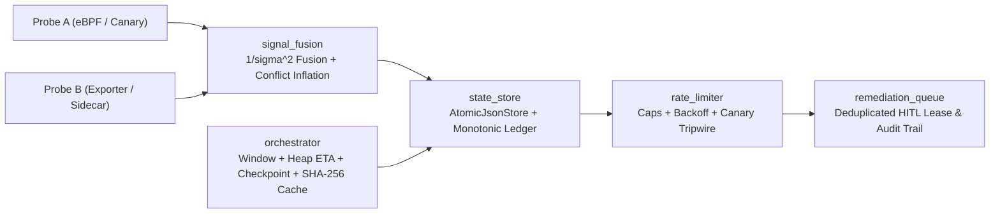

# resilient-batch-reconciler

A narrow Python reliability toolkit for multi-worker reconciliation loops on Linux and Windows hosts, requiring a single runtime dependency (`filelock`).

---

## Why This Exists

Long-running operational scripts fail in mundane, expensive ways when concurrency and partial failures show up:

1. Parallel workers doing read-modify-write on JSON state files lose updates or hit transient `PermissionError` lock contention on Windows.
2. A partially degraded telemetry probe emits `null` or empty fields and silently wipes confirmed metadata in the local inventory.
3. Two disagreeing latency sensors get averaged naively into a false high-confidence number instead of widening uncertainty.
4. A control-plane loop hits upstream rate limits and either keeps hammering the API or drops operator approvals when restarting.

`resilient-batch-reconciler` packages four primitives to stop those failure modes: cross-process locked JSON storage with fail-closed corruption quarantine, monotonic evidence reconciliation, inverse-variance multi-probe signal fusion (`1/sigma^2`), and persisted canary-aware pacing paired with a deduplicated Human-in-the-Loop (HITL) remediation queue.

## Origin & Sanitization

These modules were extracted and rewritten from private multi-worker ingestion and state-reconciliation pipelines. All original domain targets, scraping adapters, private heuristics, and operational datasets were stripped out; only the reusable synchronization, statistical fusion, pacing, and scheduling mechanics remain under an SRE inventory and remediation domain.

## What It Intentionally Does Not Do

This repository is intentionally scoped as a lightweight control-plane library (`filelock` only).

It does **not**:

- act as a full distributed CMDB or SQL database server (JSON stores fit checkpoints, rate limits, and bounded operator queues, not millions of rows)
- auto-execute destructive infrastructure mutations without explicit HITL status transitions
- replace cluster workflow engines such as Airflow or Temporal

---

## Architecture Overview



---

## Core Modules

### 1. `reconciler.state_store`: Cross-Process Atomic Store & Monotonic Ledger
- **`AtomicJsonStore`**: Pairs an in-process `threading.RLock` per resolved path with `filelock.FileLock`, PID/thread/nanosecond temporary files, and retry loops on transient `Path.replace()` lock contention. On corrupt JSON, `corrupt_policy="quarantine"` (default) writes a forensic `.corrupt.<ns>` snapshot and raises `StoreCorruptionError` rather than resetting state to `{}`.
- **`reconcile_asset_record`**: Missing, empty (`""`, `[]`, `{}`), or `None` fields in degraded observations never overwrite previously confirmed facts, while valid falsy telemetry (`0`, `0.0`, `False`) is kept. Every observation appends to `evidence_ledger` and updates `fact_provenance`.

### 2. `reconciler.signal_fusion`: Inverse-Variance Telemetry Fusion (`1/sigma^2`)
- **`fuse_probe_readings(readings, conflict_threshold, z_score=1.28)`**: Weights heterogeneous probes measuring the same metric by `w_i = 1 / sigma_eff_i^2`, returning `fused_value`, `fused_sigma`, `[ci_low, ci_high]`, `confidence`, and `primary_source`.
- **Conflict Detection & Variance Inflation**:
  - **2-probe disagreement (no majority):** inflates both probes symmetrically by `conflict_inflation_factor` (default `5.0`) so uncertainty widens without letting a noisier secondary probe flip relative precision weights.
  - **3+-probe consensus vs outlier:** when corroborating secondary probes form a majority against a stale primary, the primary sigma is inflated; when a single secondary disagrees with consensus, only the outlier variance is inflated.

### 3. `reconciler.rate_limiter` & `reconciler.remediation_queue`: Pacing & HITL Queuing
- **`RateLimiter`**: Persists UTC daily budgets, session caps, batch cooling pauses, exponential backoff, and canary tripwires (`429`, `503`, `X-Canary-Tripwire`, `/circuit-open`) with `cooldown_until` surviving restarts and midnight rollovers.
- **`HitlRemediationQueue`**: Deduplicates active items (`pending`, `leased`, `approved`) sharing a `dedup_key` and leases pending work by severity (`critical > high > medium > low`) then FIFO with explicit HITL transitions before execution.

### 4. `reconciler.orchestrator`: Windows, Fleet ETA, Checkpoints & Spec Cache
- **`compute_incremental_window`**: Adds a configurable `overlap_buffer_seconds` (default `7200s`) clamped to `[min_seconds, max_seconds]` to catch late-indexed telemetry.
- **`calibrate_median_durations` & `estimate_fleet_completion`**: Calibrates task medians and simulates parallel slot completion via a `heapq` min-heap with initial `stagger_sec` and in-flight elapsed times.
- **`StageCheckpoint` & `TemplateHashCache`**: Idempotent per-stage checkpointing plus TTL caching invalidated automatically when `sha256(spec)` changes.

---

## Installation & Quickstart

```bash
pip install -e ".[dev]"
pytest -v
python scripts/demo_reconcile.py
```

### Example

```python
from reconciler import (
    AtomicJsonStore,
    HitlRemediationQueue,
    ProbeReading,
    RemediationItem,
    fuse_probe_readings,
)

fused = fuse_probe_readings(
    [
        ProbeReading(source="ebpf_kernel", value=42.5, sigma=1.2, role="primary"),
        ProbeReading(source="envoy_sidecar", value=45.0, sigma=2.5, role="secondary"),
    ],
    conflict_threshold=15.0,
)

store = AtomicJsonStore("state/inventory.json")
record = store.reconcile_asset(
    "prod-us-east-1/checkout-01",
    {"region": "us-east-1", "latency_ms": fused.fused_value, "confidence": fused.confidence},
    source="signal_fusion",
)

queue = HitlRemediationQueue("state/remediation_queue.json")
queue.enqueue_remediations(
    [RemediationItem(asset_id="prod-us-east-1/checkout-01", action="shift_traffic", reason="p99 drift", severity="high")]
)
batch = queue.drain_batch(limit=5, reviewer="oncall-sre")
```

## License

MIT - see [LICENSE](LICENSE).
