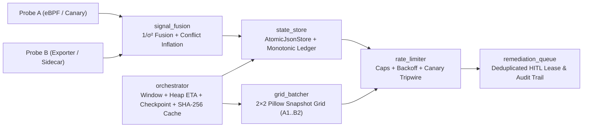

# resilient-batch-reconciler

A lightweight, production-hardened Python toolkit for **SRE Cloud Asset Reconciliation**, **Inverse-Variance Telemetry Fusion**, **Canary Tripwire Rate Limiting**, **Safe HITL Remediation Queuing**, and **2×2 Dashboard Snapshot Grid Batching**.

Designed for multi-worker reconciliation pipelines running on both Linux and Windows, it isolates operational reliability primitives—cross-process atomic storage, monotonic fact preservation, statistical sensor fusion, bounded control-plane pacing, and 4× batched visual triage—behind a clean, dependency-minimal API (`filelock` + `Pillow`).

---

## Architecture Overview



---

## Core Reliability Modules

### 1. `reconciler.state_store` — Cross-Process Atomic Persistence & Monotonic Ledger
- **`AtomicJsonStore`**: Coordinates both in-process threads (`threading.RLock` registry per canonical path) and separate OS processes (`filelock.FileLock`) around read-modify-write JSON cycles. Writes use unique PID/thread/nanosecond temporary files and retry `Path.replace()` across transient Windows `PermissionError` / `OSError` lock contention. On corrupt JSON, `corrupt_policy="quarantine"` (default) preserves a forensic `.corrupt.<ns>` snapshot and raises `StoreCorruptionError` (fail-closed) rather than silently resetting state to `{}`.
- **`reconcile_asset_record`**: Enforces a **monotonic evidence ledger invariant**:
  - Absent, empty (`""`, `[]`, `{}`), or `None` fields in degraded probes **never** overwrite previously confirmed facts (including nested map keys), while valid falsy telemetry (`0`, `0.0`, `False`) is explicitly preserved as confirmed state.
  - Every observation—including partial or degraded probes—is appended to `evidence_ledger` with `source`, `observed_at`, `observed_fields`, and `retained_fields`, alongside per-field timestamps in `fact_provenance`.

### 2. `reconciler.signal_fusion` — Inverse-Variance Telemetry Fusion ($1/\sigma^2$)
- **`fuse_probe_readings(readings, conflict_threshold, z_score=1.28)`**: Fuses heterogeneous probes measuring a common telemetry dimension (`latency_ms`, `capacity_pct`, etc.) via inverse-variance Bayesian weighting:

$$
w_i = \frac{1}{\sigma_{\text{eff}, i}^2}, \qquad
\hat{x}_{\text{fused}} = \frac{\sum_i w_i (x_i + b_i)}{\sum_i w_i}, \qquad
\sigma_{\text{fused}} = \sqrt{\frac{1}{\sum_i w_i}}
$$

- **Confidence Interval & Confidence Score**:

$$
\text{CI} = \left[\hat{x}_{\text{fused}} - z \cdot \sigma_{\text{fused}},\ \hat{x}_{\text{fused}} + z \cdot \sigma_{\text{fused}}\right]
$$

- **Conflict Detection & Automatic Variance Inflation**:
  - Selects a primary anchor probe (lowest $\sigma$ among probes marked `role="primary"`, or lowest $\sigma$ overall) and checks $|x_{\text{primary}} - x_{\text{sec}}| \ge \text{conflict\_threshold}$.
  - **2-probe disagreement (no majority):** inflates **both** probes symmetrically by `conflict_inflation_factor` (default `5.0`) so posterior uncertainty ($\sigma_{\text{fused}}$) widens cleanly without artificially reversing weights toward the noisier probe.
  - **3+-probe consensus vs outlier:** when corroborating secondary probes form a majority against a stale primary, the primary's $\sigma$ is inflated; when a minority secondary outlier disagrees with an agreeing primary consensus, only the outlier's variance is inflated.
  - Exposes `fused_value`, `fused_sigma`, `ci_low`, `ci_high`, `confidence`, `primary_source`, `conflict_flag`, `conflict_delta`, `weights`, and `effective_sigmas`.

### 3. `reconciler.rate_limiter` & `reconciler.remediation_queue` — Bounded Pacing & Safe HITL Queuing
- **`RateLimiter`**: Persists UTC daily budgets, session caps, inter-action pacing, batch cooling pauses, and exponential backoff (`min(base * 2^(k-1), max_backoff)`) into `AtomicJsonStore`.
  - **`check_canary_signal` & `trigger_canary_cooldown`**: Detects downstream throttle/freeze tripwires across HTTP status codes (`429`, `503`), response headers (`X-Canary-Tripwire`, `X-Circuit-Breaker`), endpoint paths (`/circuit-open`, `/maintenance-freeze`), and payload strings (`ThrottlingException`, `rate limit exceeded`). Persists `cooldown_until` across process restarts and UTC midnight rollovers.
- **`HitlRemediationQueue`** (`enqueue_remediations`, `drain_batch`):
  - Decouples drift detection from infrastructure mutation via an operator-reviewed queue.
  - Deduplicates against active items (`pending`, `leased`, `approved`) sharing a `dedup_key` while recording duplicate recurrence counts and permitting re-enqueue after terminal resolution (`executed` or `rejected`).
  - `drain_batch` atomically leases up to `limit` pending items ordered by severity (`critical > high > medium > low`) then FIFO, guaranteeing concurrent operators never receive the same item and enforcing HITL transitions before execution.

### 4. `reconciler.orchestrator` — Windows, Fleet ETA Simulation, Checkpoints & Spec Cache
- **`compute_incremental_window`**: Computes lookback windows since the last successful checkpoint plus a configurable `overlap_buffer_seconds` (default `7200s`) to absorb late-indexed telemetry, clamped cleanly within `[min_seconds, max_seconds]`.
- **`calibrate_median_durations` & `estimate_fleet_completion`**: Calibrates task durations from historical medians (`statistics.median`) and simulates parallel slot completion over `concurrency` workers using a `heapq` min-heap, accounting for initial `stagger_sec` and active in-flight task elapsed times.
- **`StageCheckpoint`**: Persists per-stage completed item IDs atomically for idempotent resumption (`filter_pending`).
- **`TemplateHashCache`**: Persisted TTL cache keyed by `sha256` digest of prompt/template/spec payloads; any edit to a prompt or schema invalidates stale entries automatically.

### 5. `reconciler.grid_batcher` — 2×2 Dashboard Snapshot Grid Compositor
- **`compose_snapshot_grid` & `batch_compose_snapshot_grids`**: Packs up to 4 synthetic dashboard/metric chart snapshots into a single labeled `2×2` Pillow composite (`A1`, `B1`, `A2`, `B2`), reducing downstream multimodal/vision triage calls by up to **4×**.
- Preserves bidirectional lookup (`resolve_label`, `resolve_coordinates`, `map_findings`) to map cell-keyed triage anomalies back to exact `dashboard_id`s.

---

## Installation & Quickstart

```bash
pip install -e ".[dev]"
pytest -v
python scripts/demo_reconcile.py
```

### Example

```python
from reconciler import (
    AtomicJsonStore,
    HitlRemediationQueue,
    ProbeReading,
    RemediationItem,
    compose_snapshot_grid,
    fuse_probe_readings,
)

# 1. Fuse multi-probe telemetry with conflict protection
fused = fuse_probe_readings(
    [
        ProbeReading(source="ebpf_kernel", value=42.5, sigma=1.2, role="primary"),
        ProbeReading(source="envoy_sidecar", value=45.0, sigma=2.5, role="secondary"),
    ],
    conflict_threshold=15.0,
)

# 2. Persist monotonically into an atomic cross-process asset ledger
store = AtomicJsonStore("state/inventory.json")
record = store.reconcile_asset(
    "prod-us-east-1/checkout-01",
    {"region": "us-east-1", "latency_ms": fused.fused_value, "confidence": fused.confidence},
    source="signal_fusion",
)

# 3. Enqueue bounded, deduplicated remediation if SLA breached
queue = HitlRemediationQueue("state/remediation_queue.json")
queue.enqueue_remediations(
    [RemediationItem(asset_id="prod-us-east-1/checkout-01", action="shift_traffic", reason="p99 drift", severity="high")]
)
batch = queue.drain_batch(limit=5, reviewer="oncall-sre")
```

---

## License

MIT — see [LICENSE](LICENSE).
